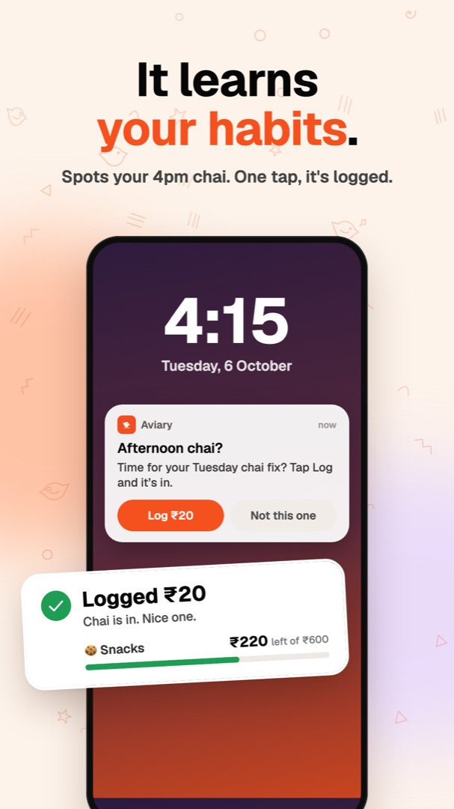
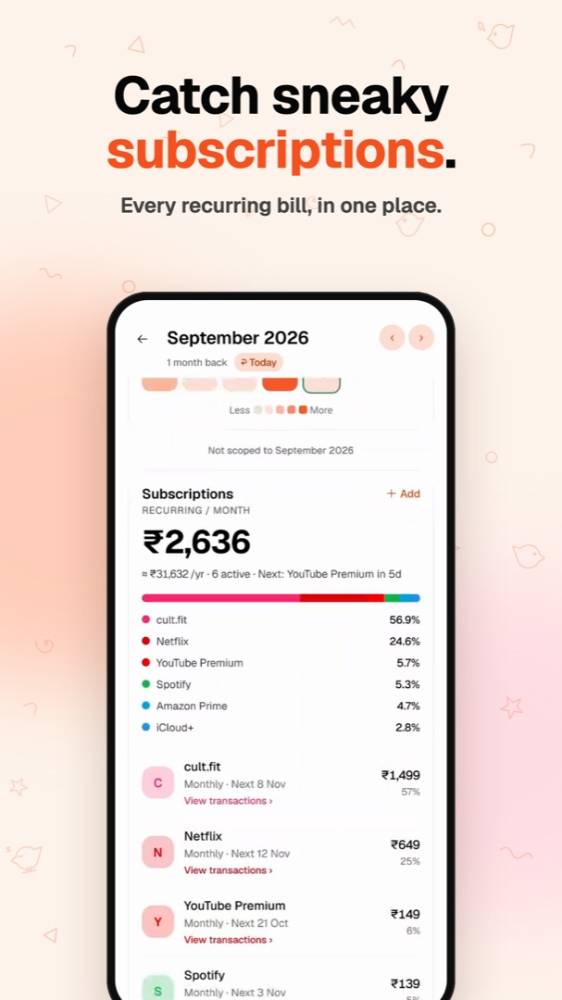

# Aviary

**The budgeting app you'll still open on day 4.** It notices your habits and nudges you while a spend is still fresh. Miss a day? Type what you remember and you're caught up. No bank link, no loans, no offers.

[Get it on Google Play](https://play.google.com/store/apps/details?id=com.sukrit04.envelope) · [Website & web app](https://www.useaviary.com) · [Web + API repo](https://github.com/Sukrittt/aviary)

<p align="center">
  
  
  
  
</p>
<p align="center">
  
  
  
</p>

## Why Aviary

Every budgeting app starts the same way, and so does the ending. You stop logging by day 4. That's not a willpower problem. Logging cost more than it gave back, so Aviary makes it cheap.

- **It learns your habits.** Log the same thing on the same weekday, around the same time, three times in eight weeks, and Aviary nudges you 15 minutes after with the details filled in. Tap Log on the notification and it's in.
- **Catch up in one line.** Missed yesterday? Type "auto 240, lunch 150, Friday dinner 900" into Ask Aviary. It splits that into separate spends, picks the categories, and you check them before they land.
- **One tap on a normal day.** A home-screen widget, a keypad where the category picks itself, receipt scanning that splits shared bills, recurring expenses that log themselves, and offline logs that sync later.
- **Noticing is the point.** There's no bank sync. Aviary keeps the one second where you notice a spend and takes away everything around it.
- **Every log is a little win.** A check, a buzz and a chime, then what's left in that category. Expense Wrapped turns your month into a recap with your spending personality and longest streak.
- **Give every rupee a job.** The envelope method YNAB made popular: Ready to Assign, categories, and moving money when you overspend. Rupees by default, or pick your own currency.
- **More in the nest.** Ask Aviary answers "can I afford it?" from your own budget, Insights shows where it all went, and every subscription gets a heads-up before it renews.

Free for 30 days, no card needed. Android and web today, with an iPhone waitlist on [useaviary.com](https://www.useaviary.com). No ads, and your data is never sold.

## About this repo

Expo/React Native app for Aviary. Talks to the same deployed API as [`Sukrittt/aviary`](https://github.com/Sukrittt/aviary).

## Stack

- Expo SDK 57 + Expo Router (file-based routing, `app/`)
- React 19 / React Native 0.86
- TanStack Query for data fetching
- expo-secure-store for token persistence
- expo-auth-session for Google sign-in (PKCE, no client secret in the bundle)
- Reanimated + gesture-handler for swipeable rows and sheets; SVG charts

## Features

- **Envelopes** — category groups with monthly budgets, Ready to Assign, move money between envelopes, inline category creation, drag reordering.
- **Activity** — transaction log with swipe-to-delete.
- **Investments** — holdings, contributions/withdrawals via modals.
- **Ask Aviary** — AI chat about your spending (`src/api/ai.ts` → `/api/ai/chat`).
- **Wrapped** — year-in-review recap screen (`app/wrapped.tsx`) backed by `/api/wrapped`.
- **Account** — profile edit, real email change with code verification, linked identities (Google/email), active sessions with remote revoke, delete account with in-app confirm sheet, data export, help.

## Structure

```
app/            routes (expo-router)
  (auth)/       welcome.tsx, email.tsx, code.tsx — sign-in flow
  (tabs)/       index (home), envelopes, activity, more
  account/      data.tsx, security.tsx, help.tsx
  modals/       log-expense, move-money, category-manager, subscription,
                add-holding, holding-action, money-brain
  investments.tsx, onboarding.tsx, wrapped.tsx
src/api/        fetch wrappers per resource (budgets, expenses, holdings,
                groups, categories, subscriptions, wrapped, ai, account,
                notifications, workos, magicAuth, accessMode, client)
src/hooks/      TanStack Query hooks wrapping src/api
src/components/ envelope, charts, nav, activity, auth, brain, onboarding,
                subscriptions, wrapped, shared UI
src/context/    PrivacyContext
src/theme/      tokens, fonts, ThemeProvider
src/lib/        format/emoji/envelope helpers
```

`src/api/client.ts` and `src/api/accessMode.ts` are ports of `Web/src/services/api.ts` and `accessMode.ts` — same real/guest auth model, but SecureStore is async so `initAccessMode()` must be awaited once at boot before rendering past the splash screen.

## Setup

```bash
npm install
npm start        # expo start
npm run ios      # expo run:ios
npm run android  # expo run:android
npm run web      # expo start --web
```

## Environment

- `EXPO_PUBLIC_API_URL` — API base URL. Falls back to `https://useaviary.com` in a release build; in a dev build (`__DEV__`), leaving it unset throws at startup instead of silently pointing at production data — set it in `.env` (gitignored).
- `EXPO_PUBLIC_WORKOS_CLIENT_ID` — WorkOS client id for Google PKCE sign-in.
- `EXPO_PUBLIC_REVENUECAT_ANDROID_KEY` — RevenueCat *public* SDK key for Google Play checkout. Public by design: it can only read and start purchases for the signed-in customer. The secret key lives server-side in Web and must never appear here. Unset simply disables checkout — the server still decides access, so the app degrades rather than breaking.

`google-services.json` (repo root, referenced by `app.json`'s `googleServicesFile`) is gitignored — keep it on disk locally (the build needs it) but never commit it. Android Firebase API keys are semi-public by design, but restrict it in the GCP console (Credentials → the key → API restrictions) to just the APIs this app actually calls, rather than leaving it unrestricted.

## Auth

Two paths, both against WorkOS:

- **Google** — PKCE flow straight from the device via `expo-auth-session` (`src/api/workos.ts`, `useSignIn.ts`); no client secret baked into the app.
- **Email** — 6-digit magic-auth codes sent through the deployed API's `/api/auth/magic-auth/*` endpoints (`src/api/magicAuth.ts`), since that flow needs the server-side API key.

Real mode stores a WorkOS token pair (access + refresh) in SecureStore; expired access tokens are refreshed transparently, and rotated refresh tokens are persisted immediately (`src/api/accessMode.ts`). Guest mode sends no auth header. The Account & security screen lists active sessions (with device labels from `expo-device`) and can revoke them.

## Notes

Expo 57 API surface differs from older docs — check `https://docs.expo.dev/versions/v57.0.0/` before assuming behavior (see `AGENTS.md`).

## License

Copyright (c) 2026 Sukrit Saha. Licensed under the [GNU Affero General Public License v3.0](LICENSE). If you run a modified version of Aviary as a service, you must publish your source code under the same license.
