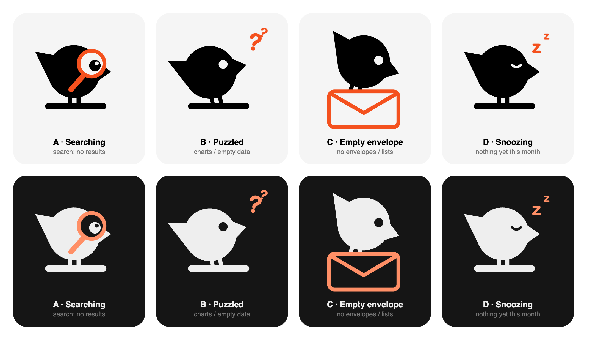

# Empty states: the Aviary bird mascot

Every empty state uses the Aviary bird (`src/components/splash/birdPath.ts`) as a
mascot. The bird stays recognisably Aviary while its pose, accent and single prop
change with the data family.

## Rules

- Each scene is the bird at full size plus one prop drawn in the bird's own line
  language: round caps, stroke width around 13 in the 512 artboard. No halo,
  orbit, icon tile or dots.
- Bird, legs and perch use `tokens.text`. The eye cut-out uses `tokens.bg`. Props
  use the subject accent: `tokens.mint` for holdings, `tokens.blue` for archive,
  `tokens.violet` for chat, `tokens.accent` for everything else.
- The prop carries the motion. The bird only bobs, pecks, nods or tilts.
- Decorative only: hidden from screen readers. The copy next to it carries the meaning.
- The scene settles first; the copy follows 60ms later. Reduced motion keeps a
  fade and a still pose with the prop visible, no loops.
- `compact` renders the same scene at 75%.
- Use an action when there's a useful next step. Empty filtered lists clear
  both the filters and search; new lists open their existing entry screen.
- Copy follows `CLAUDE.md` voice rules: short, second person, contractions, no em dashes.

The image above is the original concept sheet; the scenes below are what ships.

## The family

A subject shows its own scene in its usual mood. Pass a different `mood` (a
filter with no results, a list that hasn't started) and it shows the plain mood
scene instead (`sceneFor` in `EmptyState.tsx`). An awake mood on a subject that usually dozes or searches gets a plain bobbing bird.

| Scene | Looks like | Motion |
| --- | --- | --- |
| **Searching** (mood) | Magnifier over the eye | Lens sweeps left and right |
| **Snoozing** (mood, also `recurring`) | Eye shut in a sleepy arc, two `z`s | Head nods, `z`s drift up (`SnoozingBird.tsx`) |
| **Expenses** | Awake bird, orange coin on the perch | Coin hops, bird double-pecks toward it and blinks |
| **Subscriptions** | Dozing bird, orange repeat arrow above the head | Arrow turns once every 5s |
| **Holdings** | Bird on the tallest of three mint bars | Bars grow in with a stagger, bird bobs |
| **Scans** | Bird inside four orange viewfinder corners | Scan line sweeps down and back |
| **Chat** | Bird with a violet speech bubble | Three typing dots bounce |
| **Archive** | Bird in a blue box, clipped at the rim | Peeks up, ducks back down |
| **Envelopes** | Bird perched on an orange envelope | Tilts its head down to look at it |
| **Insights** | Bird with an orange question mark | Question mark rocks and bobs |

## Where it's used

| Screen | Empty case | Scene | Copy |
| --- | --- | --- | --- |
| Insights · "Where it went" (`CategoryBreakdown.tsx`) | No spending in the month | Expenses scene | "Nothing spent yet" / "Log an expense and it'll land here." |
| Activity | Search or filters return no transactions | Searching | "Nothing turned up" / "No transactions for this filter." |
| Activity | No transactions without filters | Snoozing | "Your story starts here" |
| Subscriptions | No tracked subscriptions | Subscriptions scene | "Keep tabs on your repeats" |
| Investments | No holdings | Holdings scene | "Room to grow" |
| Envelopes | No groups or categories | Envelopes scene | "Your envelopes are waiting" |
| Recurring | No recurring expenses | Snoozing | "Set it once, forget it" |
| Income | No recurring income | Snoozing | "What comes in?" |
| Bill scans | No scans | Scans scene | "No scans yet" |
| Chat history | No chats or no search matches | Chat scene / Searching | "No past chats yet" / "Nothing turned up" |
| Archive | No archived items or no filter matches | Archive scene / Searching | "All clear in here" / "Nothing turned up" |
| Trend charts | No points | Insights scene | Chart-specific empty note |

Use the shared component for new data-empty states so centering, accessibility,
motion and the illustration family remain consistent.
